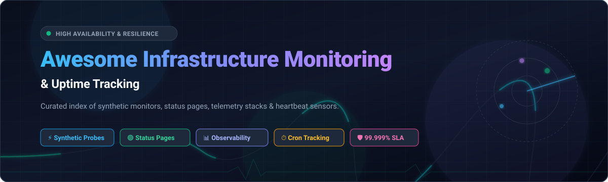

# ⚡ Awesome Infrastructure Monitoring & Uptime Tracking 🌐

  <strong>Curated directory of top infrastructure monitoring, synthetic uptime tracking, incident status page generators, heartbeat probes, and full-stack observability solutions.</strong>
   
  Featuring industry-leading SaaS platforms alongside battle-tested, high-performance open-source alternatives.

🌟 *Star this repository if you find it helpful!* 🌟

---

## 📑 Table of Contents

- [📊 Sector Overview & Market Dynamics](#-sector-overview--market-dynamics)
- [☁️ SaaS / Hosted Platforms](#️-saas--hosted-platforms)
- [🔓 Open-Source Equivalents & Tools](#-open-source-equivalents--tools)
  - [⚡ Self-Hosted Uptime Monitors & Synthetic Probes](#-self-hosted-uptime-monitors--synthetic-probes)
  - [🟢 Public Status Page & Incident Communication Tools](#-public-status-page--incident-communication-tools)
  - [📈 Full-Stack Infrastructure & Server Monitoring Suites](#-full-stack-infrastructure--server-monitoring-suites)
  - [🖥️ Lightweight Node Agents & Real-Time System Dashboards](#️-lightweight-node-agents--real-time-system-dashboards)
  - [⏱️ Cron Job, Heartbeat & SSL/DNS Expiration Trackers](#️-cron-job-heartbeat--ssldns-expiration-trackers)
- [⭐ Star History](#-star-history)
- [🤝 Contributing](#-contributing)
- [💖 Support & Sponsorship](#-support--sponsorship)

---

## 📊 Sector Overview & Market Dynamics

The global infrastructure monitoring and observability market is estimated at **$5 billion to $27 billion** (expanding toward $45B+ by 2030 at a ~7–11% CAGR), driven by multi-cloud complexity, hybrid IT stacks, and zero-downtime microservices. The sector exhibits a **moderately fragmented** structure: while mega-cap observability suites (Datadog, Dynatrace, New Relic) dominate high-end enterprise consolidation, low switching barriers and specialized needs sustain a vibrant long-tail ecosystem of lightweight SaaS synthetic monitors, independent status page builders, and self-hosted open-source alternatives.

---

## ☁️ SaaS / Hosted Platforms

Commercial, cloud-hosted uptime monitoring services, global synthetic testing networks, and managed status page platforms. Ranked by company scale (market capitalization or valuation / annual revenue, descending).

| Product | Company Size (Valuation / Revenue) | Starting Paid Pricing | Free Tier Limits / Free Trial Policy | Key Focus & Features |
| :--- | :--- | :--- | :--- | :--- |
| **[Datadog Synthetics](https://datadoghq.com)** | ~$60B Market Cap / ~$4.3B TTM Rev | $5.00/month (per 10k API test runs; Browser tests at $12 per 1k runs) | 14-day full platform free trial (Infrastructure has permanent free tier for up to 5 hosts with 1-day metric retention; Synthetics requires paid plan after trial) | Enterprise observability suite with multi-location synthetic API & browser user journey checks. |
| **[Dynatrace Synthetic Monitoring](https://dynatrace.com)** | ~$13B Market Cap / ~$2.2B TTM Rev | ~$0.001 per synthetic request (HTTP) / ~$0.0045 per synthetic action (Browser) via DPS subscription | 15-day free trial (No permanent free tier; requires annual Davis Platform Subscription commitment) | Enterprise AI-assisted synthetic monitoring simulating complex multi-step user transactions globally. |
| **[Site24x7](https://site24x7.com)** | ~$10B+ Valuation (Zoho Corp parent, ~$1.4B+ ARR) | $9/month (billed annually for Starter plan, includes 10 websites/servers) | Free forever plan: Up to 50 uptime monitors (basic website/server checks) with 10-minute check intervals and email alerting (excludes advanced APM/synthetic transactions) | All-in-one DevOps monitoring suite for websites, servers, networks, cloud infrastructure, and RUM. |
| **[New Relic Synthetics](https://newrelic.com)** | $6.5B Valuation (Acquired by Francisco Partners & TPG) / ~$1B+ Rev | $99/month (Standard plan base + overages at ~$0.005 per check beyond allotment) | Free forever plan: 100 GB/month data ingest, 1 full platform user, and up to 500 synthetic checks/month (basic ping monitors free; multi-step scripted checks eat quota) | Cloud-hosted synthetic monitoring enabling scripted browser interactions and global API validation. |
| **[SolarWinds Pingdom](https://pingdom.com)** | ~$3.2B Market Cap (SolarWinds parent, ~$795M TTM Rev) | $15/month (Synthetic plan: includes 10 uptime checks, 1 transaction check, 50 SMS credits) | 14-day free trial (No permanent free tier; trial provides full access to synthetic & RUM capabilities) | Benchmark availability, synthetic transaction verification, and real-user performance monitoring. |
| **[Better Stack (Better Uptime)](https://betterstack.com)** | ~$93M Valuation / ~$3.8M ARR | $29/month per responder (billed annually; unlocks 30-second checks and on-call routing) | Free forever plan: 10 uptime monitors, 10 heartbeats, 3-minute check intervals, 1 branded status page, and email/Slack alerting (plus 3 GB / 3-day log retention) | Modern uptime monitoring platform combining synthetic HTTP/ping checks, on-call paging, and status pages. |
| **[StatusCake](https://statuscake.com)** | ~$15M–$25M Est. Valuation / ~$3.9M ARR | $20/month (Superior plan billed annually; includes 50 uptime monitors, 1-minute checks) | Free forever plan: 10 uptime monitors, 5-minute check intervals, 1 page speed test, 1 user login, capped at 60 API req/min | Uptime alerts, page speed tracking, SSL expiration checks, and public status pages. |
| **[UptimeRobot](https://uptimerobot.com)** | ~$12M–$20M Est. Valuation / ~$3.5M ARR | $7/month (Solo plan billed annually; 60-second checks, 10 monitors, SMS alerts) | Free forever plan: 50 monitors (HTTP/ping/port/keyword), 5-minute check frequency, 1 branded status page, 3 months data retention, and email alerts only | Widely-used freemium uptime monitor supporting HTTP(S), ping, port, and cron heartbeat monitoring. |
| **[Pulsetic](https://pulsetic.com)** | ~$3M–$6M Est. Valuation (Designmodo parent, ~$1.2M–$3.4M Rev) | $9/month (Solo plan: 50 monitors, 30-second checks, multi-channel alerts) | Free forever plan: 10 monitors, 5-minute check frequency, 3 status pages, 3 months history, email-only alerting (commercial use allowed) | Multi-region uptime monitoring, incident management, and customizable badge status pages. |
| **[Instatus](https://instatus.com)** | ~$1.5M–$2.5M Est. Valuation / ~$400K ARR | $15/month (Pro plan billed annually; custom domains, unlimited subscribers, 30-sec checks) | Free forever plan (Starter): 15 monitors, 2-minute check intervals, 200 email subscribers, 5 team members, 1-week incident log history, hosted on .instatus.com subdomain | Ultra-fast hosted status page platform with automated incident communication and check integrations. |

---

## 🔓 Open-Source Equivalents & Tools

Free and open-source software (FOSS) self-hosted uptime trackers, status pages, Prometheus/metrics stacks, lightweight server monitors, and cron heartbeat tools. Each project features an interactive GitHub Stars_Badge linking to its stargazers page and is sorted by Stars_Count in descending order.

### ⚡ Self-Hosted Uptime Monitors & Synthetic Probes

* **[Uptime Kuma](https://github.com/louislam/uptime-kuma)**  - The premier self-hosted, fancy monitoring tool supporting HTTP(S), TCP, Ping, DNS, Docker containers, Steam game servers, and 90+ notification services.
* **[changedetection.io](https://github.com/dgtlmoon/changedetection.io)**  - Self-hosted website change detection, defacement monitoring, uptime validation, and content difference alerting engine.
* **[Gatus](https://github.com/TwiN/gatus)**  - Developer-oriented, automated health dashboard written in Go evaluating HTTP, ICMP, TCP, and DNS endpoints with custom alerting and status badges.
* **[OneUptime](https://github.com/oneuptime/oneuptime)**  - Complete open-source observability and reliability platform combining uptime monitoring, status pages, incident management, and on-call schedules.
* **[Prometheus Blackbox Exporter](https://github.com/prometheus/blackbox_exporter)**  - Official Prometheus exporter allowing blackbox probing of endpoints over HTTP, HTTPS, DNS, TCP, ICMP, and gRPC.
* **[Tianji](https://github.com/msgbyte/tianji)**  - All-in-one open-source insight hub combining website analytics, uptime monitoring, and server status tracking in a single lightweight binary.
* **[Uptime Guard](https://github.com/CalmRay-Solutions/Uptime-Guard)**  - Open-source uptime tracking and infrastructure monitoring solution engineered for service availability checks.

### 🟢 Public Status Page & Incident Communication Tools

* **[OpenObserve](https://github.com/openobserve/openobserve)**  - Cloud-native observability platform built in Rust for metrics, logs, traces, synthetic probes, and alerting with ultra-low storage footprint.
* **[Upptime](https://github.com/upptime/upptime)**  - Open-source uptime monitor and status page powered entirely by GitHub Actions, Issues, and GitHub Pages without requiring a server.
* **[Cachet](https://github.com/cachethq/cachet)**  - Beautiful open-source status page system built in PHP/Laravel for communicating service outages and scheduled maintenance.
* **[Statping](https://github.com/hunterlong/statping)**  - Open-source status page and monitoring server written in Go with notification dispatchers and incident logs.
* **[Kener](https://github.com/rajnandan1/kener)**  - Sleek, modern open-source status page built with SvelteKit, Node.js, and GitHub Issues integration.
* **[cState](https://github.com/cstate/cstate)**  - Ultra-fast, static, open-source status page generator built on Hugo with zero database overhead and high resilience during outages.
* **[Statping-ng](https://github.com/statping-ng/statping-ng)**  - Community-maintained open-source status page and monitoring server written in Go with Prometheus exporter.
* **[Vigil](https://github.com/valeriansaliou/vigil)**  - Microservices status page and probe supervisor written in Rust featuring active probes and webhook reporters.

### 📈 Full-Stack Infrastructure & Server Monitoring Suites

* **[Netdata](https://github.com/netdata/netdata)**  - Real-time, per-second infrastructure monitoring and troubleshooting platform with zero-configuration auto-discovery.
* **[Grafana](https://github.com/grafana/grafana)**  - Leading open-source observability and data visualization platform unifying metrics, logs, traces, and synthetic alerts.
* **[Prometheus](https://github.com/prometheus/prometheus)**  - CNCF-graduated open-source systems monitoring and alerting toolkit featuring a multi-dimensional time-series database and PromQL.
* **[SigNoz](https://github.com/SigNoz/signoz)**  - Open-source OpenTelemetry-native APM and infrastructure observability platform serving as an alternative to Datadog and New Relic.
* **[Jaeger](https://github.com/jaegertracing/jaeger)**  - CNCF-graduated open-source distributed tracing platform for monitoring microservices transactions and latency bottlenecks.
* **[VictoriaMetrics](https://github.com/VictoriaMetrics/VictoriaMetrics)**  - Fast, cost-effective, scalable open-source time-series database and monitoring solution compatible with Prometheus.
* **[Zabbix](https://github.com/zabbix/zabbix)**  - Mature, enterprise-grade open-source monitoring solution for networks, servers, virtual machines, and cloud services.
* **[Checkmk (Raw Edition)](https://github.com/Checkmk/checkmk)**  - Comprehensive open-source IT infrastructure monitoring suite providing hybrid cloud, container, and network visibility.
* **[Sensu Go](https://github.com/sensu/sensu-go)**  - Observability pipeline that delivers monitoring as code across hybrid cloud infrastructures and bare metal servers.

### 🖥️ Lightweight Node Agents & Real-Time System Dashboards

* **[btop++](https://github.com/aristocratos/btop)**  - Resource monitor showing usage and stats for processor, memory, disks, network, and processes in a responsive C++ terminal UI.
* **[Glances](https://github.com/nicolargo/glances)**  - Cross-platform open-source system monitoring tool written in Python with a web UI, REST API, and export modules.
* **[Beszel](https://github.com/henrygd/beszel)**  - Lightweight, modern server monitoring hub featuring Docker statistics, historical charts, multi-user support, and simple agent setup.
* **[Cockpit](https://github.com/cockpit-project/cockpit)**  - Web-based graphical interface for Linux servers enabling real-time system health monitoring, service management, and container logs.
* **[bottom](https://github.com/ClementTsang/bottom)**  - Customizable cross-platform graphical process/system monitor written in Rust for lightning-fast terminal usage.

### ⏱️ Cron Job, Heartbeat & SSL/DNS Expiration Trackers

* **[Healthchecks](https://github.com/healthchecks/healthchecks)**  - Open-source cron job and background task monitoring service listening for periodic HTTP pings and alerting on silent failures.
* **[Diun](https://github.com/crazy-max/diun)**  - CLI application to receive notifications when Docker images are updated on a registry.
* **[Lychee](https://github.com/lycheeverse/lychee)**  - Fast, asynchronous link and endpoint checker written in Rust to validate HTTP, HTTPS, and email availability across infrastructures and documentation.

---

## 📈 Star History

---

## 🤝 Contributing

Contributions are welcome! Feel free to open a Pull Request to add more open-source uptime trackers, synthetic monitoring tools, status page generators, or infrastructure observability platforms.

1. Fork the repository.
2. Add your project under the appropriate category with a concise description and correct repository link.
3. Submit a Pull Request.

---

## 💖 Support & Sponsorship

Thank you for exploring and using **Awesome-Infrastructure-Monitoring-Uptime-Tracking**! If you find this resource valuable, please consider:
- 🌟 **Starring** the repository to help others discover it.
- 🍴 **Forking** and contributing new tools, benchmarks, and updates.
- 📣 **Sharing** it with colleagues, DevOps communities, and fellow developers.
- ☕ **Buying a coffee / Sponsoring**: Support ongoing maintenance and open-source curation via the [GitHub Sponsor Dashboard](https://github.com/sponsors/ishandutta2007).
